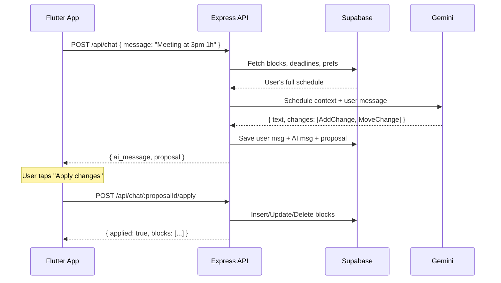

# Chrono Backend — Setup & Integration Guide

## Project Structure

```
chrono_app/backend/
├── server.js                    ← Entry point
├── supabase-schema.sql          ← Run this in Supabase SQL Editor first
├── supabase-grants.sql          ← Table permissions (already at the end of the schema)
├── scripts/e2e-test.mjs         ← npm run test:e2e (needs the server running)
├── .env.example                 ← Copy to .env and fill in keys
├── package.json
└── src/
    ├── config/
    │   ├── supabase.js          ← Supabase admin + per-user client
    │   └── gemini.js            ← Gemini model setup
    ├── middleware/
    │   └── auth.js              ← JWT auth middleware (requireAuth)
    ├── routes/
    │   ├── auth.js              ← /api/auth  (signup, login, refresh)
    │   ├── blocks.js            ← /api/blocks
    │   ├── courses.js           ← /api/courses
    │   ├── deadlines.js         ← /api/deadlines
    │   ├── preferences.js       ← /api/preferences
    │   └── chat.js              ← /api/chat  ← THE CORE FEATURE
    ├── services/
    │   └── chrono-ai.js         ← Gemini prompt + change validation
    └── utils/
        └── time.js              ← Schedule math (ported from Dart)
```

---

## Step 1 — Set up Supabase

1. Go to [supabase.com](https://supabase.com) → **New Project**
2. After it loads, go to **SQL Editor** and run the full contents of:
   [`supabase-schema.sql`](supabase-schema.sql). It ends with the GRANTs newer Supabase projects
   need; without them the backend gets "permission denied" (they are also in [`supabase-grants.sql`](supabase-grants.sql)).
3. Go to **Settings → API** and copy:
   - **Project URL** → `SUPABASE_URL`
   - **anon public** key → `SUPABASE_ANON_KEY`
   - **service_role** key → `SUPABASE_SERVICE_KEY`

> [!CAUTION]
> Never expose the `service_role` key on the client side. It stays server-only in `.env`.

---

## Step 2 — Get a Gemini API Key

1. Go to [aistudio.google.com/apikey](https://aistudio.google.com/apikey)
2. Click **Create API key** → copy it → `GEMINI_API_KEY`

`gemini-2.0-flash` and `gemini-2.5-flash` are retired. The server tries the models listed in `GEMINI_MODEL`
in order and moves to the next one when a model is overloaded or out of quota.

---

## Step 3 — Configure `.env`

```bash
# In chrono_app/backend/
copy .env.example .env
```

Fill in [`.env`](.env.example):

```env
SUPABASE_URL=https://your-project.supabase.co
SUPABASE_ANON_KEY=your-anon-key          # or the new sb_publishable_… key
SUPABASE_SERVICE_KEY=your-service-role-key   # or the new sb_secret_… key
GEMINI_API_KEY=your-gemini-api-key
GEMINI_MODEL=gemini-flash-lite-latest,gemini-3-flash-preview,gemini-3.8-flash,gemini-flash-latest
PORT=3000
```

---

## Step 4 — Run the Server

```powershell
cd chrono_app\backend
npm install    # first time only
npm run dev    # dev mode (auto-reloads on file changes)
```

You should see:
```
  🕐 Chrono backend running on http://localhost:3000
```

---

## API Quick Reference

All routes except `/api/auth/*` and `/api/health` require:
```
Authorization: Bearer <access_token>
```

### Auth
| Method | URL | Body |
|--------|-----|------|
| POST | `/api/auth/signup` | `{ email, password, name? }` |
| POST | `/api/auth/login` | `{ email, password }` |
| POST | `/api/auth/refresh` | `{ refresh_token }` |

### Core App Data
| Method | URL | Notes |
|--------|-----|-------|
| GET | `/api/blocks` | Add `?day=3` to filter by day |
| POST | `/api/blocks` | `{ day, title, kind, start_min, end_min }` |
| PUT | `/api/blocks/:id` | Update any field |
| DELETE | `/api/blocks/:id` | — |
| POST | `/api/blocks/:id/done` | Toggle done |
| POST | `/api/blocks/:id/push` | `{ minutes: 30 }` |
| GET | `/api/courses` | — |
| POST | `/api/courses` | `{ name, days[], start_min, end_min, room }` |
| POST | `/api/courses/:id/toggle` | Toggle selected |
| POST | `/api/courses/generate-blocks` | Rebuilds lecture blocks |
| GET | `/api/deadlines` | — |
| POST | `/api/deadlines` | `{ title, estimate, due }` |
| POST | `/api/deadlines/:id/toggle` | Toggle done |
| GET | `/api/preferences` | — |
| PUT | `/api/preferences` | `{ name, focus_window, bedtime, break_minutes, onboarding_complete }` |

### Chat (AI Core)
| Method | URL | Notes |
|--------|-----|-------|
| GET | `/api/chat` | Full message history |
| POST | `/api/chat?tz=Asia/Jakarta` | `{ message }` → AI response + proposal |
| POST | `/api/chat/:id/apply` | Apply changes to schedule |
| POST | `/api/chat/:id/dismiss` | Dismiss a proposal |
| DELETE | `/api/chat` | Clear history |

---

## How the Chat Flow Works



---

## Connecting to the Flutter App

The key change in the Flutter code is in [`app_state.dart`](file:///C:/Michael/Coding/Entre/Chrono-main/lib/state/app_state.dart) — the `send()` method currently calls the local `respond()` function. Replace it with an HTTP call to `POST /api/chat`.

The response structure maps like this:

| Backend JSON | Flutter class |
|---|---|
| `ai_message.content` | `TextMessage.text` |
| `proposal.changes` | `List<Change>` (AddChange / MoveChange / RemoveChange) |
| `proposal.id` | Used in `/apply` and `/dismiss` calls |
| `new_deadline` | `Deadline` object |

---

## Data Types Reference

### `kind` values
`lecture` · `focus` · `task` · `personal` · `breakTime`

### `focus_window` values
`morning` · `afternoon` · `night`

### `origin` values
`added` · `moved` · `null`

### Time fields
All `start_min` / `end_min` are **minutes from midnight**.
- `8:00` → `480`
- `13:30` → `810`
- `22:00` → `1320`

---

> [!TIP]
> Pass `?tz=Asia/Jakarta` (or your timezone) on the `POST /api/chat` request so "today" and "now" are computed correctly for the user's local time.
